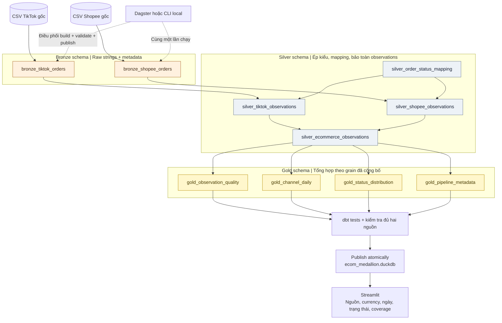

# E-commerce observations pipeline — TikTok & Shopee

Pipeline batch local với **Dagster + dbt + DuckDB + Streamlit**. Cả TikTok và Shopee đã có luồng end-to-end, được tổ chức đồng bộ theo folder, schema và prefix bảng **Bronze → Silver → Gold**.

Dữ liệu nguồn đã che thông tin vì bảo mật. Một observation là một record CSV, không mặc định là một đơn hoặc SKU duy nhất. Pipeline giữ mọi record và không dedup theo masked ID.

## 1. Luồng dữ liệu đang triển khai



| Tầng | Folder dbt | Schema thật | Ví dụ bảng |
|---|---|---|---|
| Bronze | `models/bronze/` | `bronze` | `bronze.bronze_shopee_orders` |
| Silver | `models/silver/` | `silver` | `silver.silver_shopee_observations` |
| Gold | `models/gold/` | `gold` | `gold.gold_observation_quality` |

Bronze giữ nguyên các cột nguồn dưới dạng VARCHAR, thêm fingerprint/record ordinal/ingestion metadata. **Staging và ép kiểu thuộc Silver**, đã được đổi tên và materialize thành bảng để thực thi đầy đủ các cast. Gold có schema contracts và metric definitions rõ.

Không thêm Airflow, Docker hoặc dịch vụ database mới. Các tầng nằm trong cùng DuckDB local; file CSV nguyên bản vẫn được giữ nguyên.

## 2. Chạy end-to-end

Từ repo root, dùng môi trường Python hiện có:

```powershell
# Build cả hai nguồn, chạy tests, rồi publish database đã kiểm chứng
.venv/Scripts/python.exe scripts/build_warehouse.py

# Mở dashboard đọc Gold của warehouse mới
.venv/Scripts/streamlit.exe run dashboards/streamlit_app/app.py

# Hoặc dùng Dagster để điều phối cùng luồng build/validate/publish
.venv/Scripts/dagster.exe dev -m pipeline_orchestration.definitions
```

Dagster: chọn tất cả assets trong `ecommerce_dbt_assets`; publish cần đủ hai nguồn, không nhận subset. Lịch được khai báo lúc 07:00 và 15:00 theo `Asia/Ho_Chi_Minh`; bật schedule trong Dagster khi có nhu cầu. Chạy lại snapshot không có nghĩa nguồn đã có dữ liệu thị trường mới.

Default output: `data/duckdb/ecom_medallion.duckdb`. File `ecom_warehouse.duckdb` cũ được giữ nguyên; dashboard mới không đọc các mart cũ. Mỗi lần build dùng candidate DB cùng volume và basename, giữ OS writer lock, chạy tests/reconciliation rồi atomic replace. Khi đã có warehouse mới, lần publish sau lưu backup trước khi thay. Lỗi trước publish giữ nguyên bản tốt gần nhất. Dashboard cache dataframes và đóng connection sau mỗi lần đọc để không giữ file lock.

## 3. Kiểm thử

```powershell
.venv/Scripts/python.exe scripts/validate_ecommerce_dbt.py
.venv/Scripts/python.exe scripts/validate_ecommerce_dbt.py --real-data
.venv/Scripts/python.exe scripts/validate_dashboard.py
.venv/Scripts/python.exe scripts/validate_dagster.py
```

Validator dùng project và DB riêng dưới `.validation/`; không viết vào CSV hoặc warehouse đang phục vụ. Fixture hai nguồn có masked-key collisions, exact duplicates, quoted multiline cells, missing price, escrow âm và return request. Regression kiểm tra status/cast/quantity, mapping fan-out, identical rerun, thay một file không đổi identity nguồn còn lại, publish và failed-build recovery. CI chạy fixture và kiểm tra filter dashboard, không cần raw CSV riêng tư.

## 4. Phạm vi phân tích

- So sánh số observations, trạng thái, các giá/quantity ghi nhận và coverage theo nguồn/currency/ngày; UI có lựa chọn kỳ giao nhau theo ngày.
- Không cộng tiền khác currency hoặc biến record count thành order count. UI không trình bày AOV, doanh thu theo đơn, thị phần hay cùng SKU khi chưa có khóa đáng tin.
- Shopee `TO_RETURN` là **yêu cầu trả hàng**, tách khỏi `RETURNED`. `completed_time` không được thay thành `delivered_time`.
- Giá bán Shopee thiếu vẫn là null; không lấy original price để tự điền. Escrow âm được giữ lại, không clamp về 0. Các trường phí/escrow native ở Silver Shopee không ép vào payout TikTok.
- `last_build_at` là thời điểm build. Phạm vi ngày ghi nhận của từng source được hiển thị riêng, không khẳng định completeness hoặc tính đại diện thị trường.

## 5. Cấu hình và tài liệu

Các env vars `TIKTOK_CSV_PATH`, `SHOPEE_CSV_PATH`, `DBT_DUCKDB_PATH` nhận đường dẫn tuyệt đối nếu cần đổi input/output. Mặc định CLI đọc hai file dưới `data/raw/`. Với lệnh dbt trực tiếp từ `dbt_transforms`, profile dùng các đường dẫn tương đối mặc định tương ứng. Khuyến nghị build qua CLI/Dagster để có writer lock, validation và publication.

- [Schema/metric contract, mapping cột và migration](dbt_transforms/models/README.md)
- [Lệnh vận hành](CHEATSHEET.md)
- [Kế hoạch và trạng thái triển khai](docs/UPGRADE_PLAN.md)
- [Audit CSV gốc](docs/upgrade/CSV_AUDIT.md) và [source contract](docs/upgrade/SOURCE_CONTRACTS.md)

Bronze/Silver/Gold thể hiện trách nhiệm dữ liệu; không phục hồi thông tin đã mask. Các kết quả audit cũ là bằng chứng tại thời điểm kiểm tra, không phải danh sách model active hiện tại.
