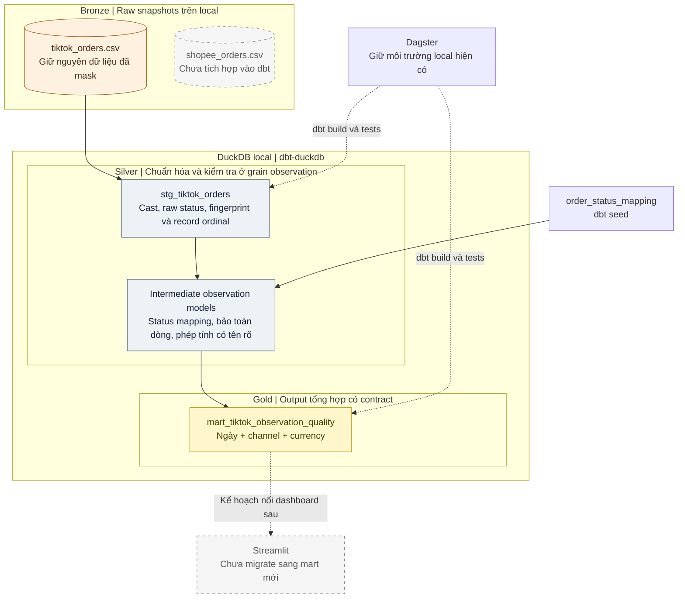
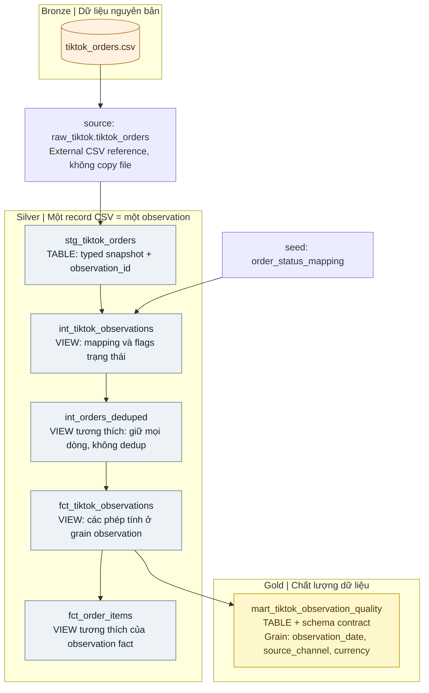

# TikTok Orders Pipeline — hướng tới phân tích Shopee và TikTok

Pipeline batch chạy local với **Dagster + dbt-duckdb + DuckDB + Streamlit**. Nhánh TikTok hiện bảo toàn từng dòng CSV, chuẩn hóa trạng thái và tạo mart chất lượng dữ liệu. Hai snapshot đầu vào đã che thông tin vì bảo mật; không dùng masked ID để suy ra số đơn hoặc sản phẩm duy nhất.

**Trạng thái:** TikTok và dbt tests đã cập nhật; Shopee chưa tích hợp vào models; Streamlit chưa chuyển sang mart mới. Những sơ đồ bên dưới mô tả định nghĩa pipeline hiện tại và output sau khi build, không khẳng định working warehouse/dashboard đã được migrate.

## 1. Nguồn dữ liệu và grain

Người dùng xuất hai CSV trực tiếp từ bộ `vietnam_ecommerce` của Xóm Dataset bằng DataGrip:

| Snapshot | Record CSV | Cột | Tích hợp hiện tại |
|---|---:|---:|---|
| TikTok | 102.000 | 71 | Có staging, observation models và quality mart |
| Shopee | 25.546 | 84 | Đã audit file; chưa có model Shopee |

Một **observation** là một record trong snapshot CSV. `pkId`, mã đơn và nhiều ID/nhãn đã bị che nên distinct mask không đồng nghĩa distinct order/SKU. Giữ nguyên mọi record; không dedup theo các ID này. Các trường tiền header không cộng trực tiếp trên toàn bộ observations.

Chi tiết: [CSV audit](docs/upgrade/CSV_AUDIT.md) và [hợp đồng nguồn](docs/upgrade/SOURCE_CONTRACTS.md).

## 2. Kiến trúc tổng thể — Bronze → Silver → Gold



Mũi tên liền thể hiện luồng dữ liệu active; nét đứt có nhãn thể hiện điều phối hoặc kết nối dự kiến. Dagster gọi `dbt build`, còn dbt quản lý dependency giữa các model và tests. Shopee được vẽ như input đang có nhưng chưa nối vào luồng active.

Bronze hiện là các file CSV bất biến, chưa phải một raw table ingestion service hay lakehouse đầy đủ. Silver và Gold nằm trong cùng DuckDB; không cần đổi môi trường hoặc thêm database chỉ để dùng cách chia tầng này.

## 3. Lineage chi tiết của nhánh TikTok đang chạy



`int_orders_deduped` và `fct_order_items` giữ tên để tương thích lineage, không còn khẳng định grain là đơn hoặc SKU duy nhất. `fct_orders` và năm mart theo đơn/SKU cũ đã `enabled=false`, nên không xuất hiện trong flow active.

### Ý nghĩa từng tầng

| Tầng logic | Thành phần hiện tại | Trách nhiệm |
|---|---|---|
| **Bronze — raw** | `data/raw/*.csv` | Bảo toàn snapshot và masking; dùng lại được để audit/reprocess |
| **Silver — chuẩn hóa** | `models/staging/` và các observation models trong `models/intermediate/` | Cast, lineage/key kỹ thuật, chuẩn hóa status, bảo toàn records và kiểm tra dữ liệu |
| **Gold — tổng hợp** | `models/marts/mart_tiktok_observation_quality.sql` | Tổng hợp số observations và coverage theo ngày/channel/currency để phục vụ theo dõi chất lượng |

**Medallion và thư mục dbt là hai cách mô tả khác nhau.** Bronze/Silver/Gold nói về trách nhiệm của tầng dữ liệu; staging/intermediate/marts nói về cách tổ chức transformation. Vì `stg_tiktok_orders` đã cast và chuẩn hóa, project xếp nó vào Silver, không gọi staging là Bronze chỉ theo tên thư mục.

Gold hiện phục vụ chất lượng dữ liệu ở grain observation. Tên Gold không khôi phục ID đã che, không xác thực số đơn/AOV và không biến phép trừ tiền thành payout. Đây là cách áp dụng pattern medallion theo phạm vi nhỏ trên local; tham khảo [định nghĩa medallion của Databricks](https://docs.databricks.com/aws/en/lakehouse/medallion).

## 4. Kiểm thử và chạy local

Từ repo root, dùng Python environment đang có:

```powershell
.venv/Scripts/python.exe scripts/validate_tiktok_dbt.py
.venv/Scripts/python.exe scripts/validate_tiktok_dbt.py --real-data
```

Các lệnh này build trong project/DB riêng dưới `.validation/`, không viết vào hai CSV hoặc working warehouse. Bộ kiểm tra bao gồm 51 dbt data tests, fixture có masked-key collision, exact duplicate, multiline cell, mapping fan-out, rerun và input sai. CI chạy fixture mà không cần CSV riêng tư.

Xem [active model contract và hướng dẫn Dagster](dbt_transforms/models/README.md) trước khi build vào database đang dùng.

## 5. Cấu trúc liên quan

```text
TikTok_orders_pipeline/
├── data/
│   ├── raw/                         # Bronze: snapshot CSV gốc
│   └── duckdb/                      # DuckDB local, không commit dữ liệu
├── dbt_transforms/
│   ├── models/
│   │   ├── staging/                 # Silver: cast và metadata snapshot
│   │   ├── intermediate/            # Silver: observations/mapping và compatibility views
│   │   └── marts/                   # Gold: quality mart đang active
│   ├── seeds/                       # Mapping tham chiếu, không phải luồng giao dịch Bronze
│   └── tests/                       # Quality checks và reconciliation
├── pipeline_orchestration/          # Dagster điều phối dbt build
├── dashboards/streamlit_app/         # Dashboard cũ, chưa migrate
├── tests/fixtures/                  # Dữ liệu synthetic nhỏ để test logic
├── scripts/validate_tiktok_dbt.py
└── docs/                           # Audit và plan hiện tại
```

Đây là mapping logic; tên thư mục/schema vật lý vẫn giữ nguyên. Các bảng legacy có sẵn trong working warehouse không tự bị xóa khi model bị disabled, và không được refresh bởi nhánh mới. Phần Shopee và migration dashboard được để lại cho bước tiếp theo trong [kế hoạch](docs/UPGRADE_PLAN.md).
