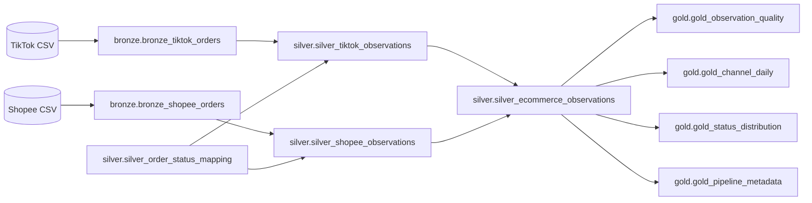

# Medallion contract — hai nguồn end-to-end

Mọi model active dùng đúng folder/schema/prefix `bronze`, `silver`, `gold`. Không còn các compatibility views `int_orders_deduped`/`fct_order_items` hoặc folder staging/intermediate/marts trong graph active. Lịch sử model cũ được giữ trong Git.

## Physical lineage



## Bronze

Hai bảng raw vật lý lưu mọi cột CSV nguyên bản dưới dạng VARCHAR, thêm:

- `observation_id = sha256(channel | file_sha256 | CSV_record_ordinal)`.
- `_source_row_number`: thứ tự record CSV, không phải physical line; quoted multiline cells không làm lệch ordinal.
- `_file_sha256`, `_source_file`, `_ingested_at`, `source_channel`.

Giữ tất cả record, kể cả nội dung giống nhau và masked ID trùng. Fingerprint theo toàn bộ nội dung file: cùng file giữ cùng observation IDs; đổi file ở cùng đường dẫn tạo snapshot identity mới. Đây không phải business identity bền vững xuyên các snapshot. Source phải bất biến trong suốt build; validator đối chiếu fingerprint trước publication.

## Silver

Các bảng Silver được materialize để mọi cast thực thi, kể cả cột không được Gold truy vấn. Cast sai fail build; missing tùy chọn giữ null. Required fields và integer quantity được test riêng.

### Mapping Shopee

| Source field | Silver field / policy |
|---|---|
| `order_sn` | `order_id`, là mask, không unique test nghiệp vụ |
| `create_time`, `pay_time`, `cancel_time`, `update_time` | `created_time`, `paid_time`, `cancelled_time`, `updated_time` |
| `synced_at` | `synced_updated_at`; không dùng làm export date |
| `shipped_time`, `completed_time` | Giữ đúng nghĩa; không suy ra delivered time |
| `item_id`, `model_id` | `product_id`, `sku_id`; chưa đủ làm identity hoặc đối sánh cross-channel |
| `item_sku`, `model_sku` | Giữ riêng code nguồn |
| `original_price`, `model_discounted_price` | `item_original_price`, `item_sale_price`; missing sale price giữ null |
| `total_order_value`, `buyer_total_amount` | Native header amounts, không additive theo observation |
| Commission/service/transaction fee, vouchers, escrow | Giữ riêng trong Silver Shopee; escrow âm được chấp nhận như observed value |
| `is_primary_row` | Giữ source flag; không dùng nó tự phục hồi order identity |
| `TO_RETURN` | `standardized_status=RETURN_REQUESTED`, `is_return_requested=1`, `is_returned=0` |
| Delivery timestamp / delivery SLA | Null có kiểu vì source không có cột tương đương |

TikTok giữ tên/các phép tính native đã typed. `amount_excluding_reported_shipping_tax_and_fees` chỉ mô tả phép trừ, không phải seller payout/profit; optional missing component giữ kết quả null.

`silver_order_status_mapping` là seed reference. Join theo `(source_channel, normalized order_status)`, chuẩn hóa trim/uppercase và `CANCELED → CANCELLED`. Raw status vẫn được giữ. Unknown status và duplicate mapping fail tests.

`silver_ecommerce_observations` union all danh sách cột tương thích: technical metadata, status và flags, currency, các mốc thời gian chung, quantity, reported unit prices và observed item value. Không union header fees/payout khác semantics. Mọi record từ từng nguồn có đúng một observation ở bảng chung; IDs không trùng giữa nguồn.

## Gold và công thức

| Table | Grain | Trách nhiệm |
|---|---|---|
| `gold_observation_quality` | date/channel/currency | Record/status/masking/missing-price/timestamp/SLA coverage counts |
| `gold_channel_daily` | date/channel/currency | Observed quantities/prices và price coverage; không phải doanh thu đơn |
| `gold_status_distribution` | date/channel/currency/standardized_status/status_group | Phân bố trạng thái ở grain record |
| `gold_pipeline_metadata` | channel/currency/file_sha256 | Min/max event date, row count, build timestamp |

Công thức price: `observed_sales_value_sum = SUM(item_sale_price * quantity)` trên records có giá; `priced_unit_count` chỉ cộng quantity của records có giá. Giá có trọng số = tổng observed value / tổng priced units, null khi không có priced units. Khi gộp ngày, tính lại từ tổng numerator/denominator, không average các average ngày. Không điền missing price bằng 0; giá nguồn ghi 0 vẫn là một giá có dữ liệu.

SLA: eligible chỉ khi có cả delivered_time và delivery_sla_time; on-time + late = eligible. Coverage = eligible / observations. Coverage bằng 0 ở Shopee thể hiện không đủ trường để đo, không phải tỷ lệ giao trễ hoặc đúng hạn.

Các tổng giá/quantity chỉ mô tả observations trong snapshot. Không gọi chúng là order count, GMV, AOV, net revenue, market share hoặc comparison của cùng SKU. Timezone các source timestamps chưa được xác nhận; không tự chuyển đổi event dates. `_ingested_at`/`last_build_at` là build instant; UI hiển thị theo Asia/Bangkok.

## Build, validation và publication

CLI `scripts/build_warehouse.py` và Dagster giữ cùng OS writer lock. Full candidate luôn có cả hai nguồn. Model/seed/tests chạy xong mới kiểm tra exact physical names, source fingerprints, raw/Silver/union uniqueness/counts và Gold reconciliation, rồi checkpoint/đóng candidate và atomic replace warehouse.

Candidate giữ cùng basename với destination; điều này cũng tránh lỗi catalog references nếu về sau có views. Build directory nằm cùng volume dưới `data/duckdb/.builds/`. Lần thay warehouse mới đã tồn tại giữ backup có timestamp. Failed build trước publish không thay bản cũ. Dashboard không cache connection, chỉ cache dataframes theo file signature; publish có retry ngắn nếu reader Windows đang mở file.

Default output là `data/duckdb/ecom_medallion.duckdb`. File legacy `ecom_warehouse.duckdb` và raw CSV được giữ nguyên. Không drop/rename destructive các bảng trong file cũ. Thay đổi vật lý được triển khai trong catalog mới, không tồn tại stale legacy marts trong database dashboard mới.

Dagster cần materialize toàn bộ `ecommerce_dbt_assets` cho mỗi candidate; subset bị từ chối để không publish warehouse thiếu nguồn hoặc Gold tables. Manifest được tạo sau CLI build thành công; `dagster dev` cũng prepare manifest trong development.

## Validation

Từ repo root:

```powershell
.venv/Scripts/python.exe scripts/validate_ecommerce_dbt.py
.venv/Scripts/python.exe scripts/validate_ecommerce_dbt.py --real-data
.venv/Scripts/python.exe scripts/validate_dashboard.py
.venv/Scripts/python.exe scripts/validate_dagster.py
```

Tests dùng fixture public nhỏ và DB/project riêng dưới `.validation/`. Dùng `scripts/validate_ecommerce_dbt.py` cho cả hai nguồn. CI kiểm tra fixture, failed build recovery và dashboard filters; không cần dữ liệu riêng tư. Local `--real-data` đọc cả hai snapshot và đối chiếu mọi record/fingerprint.

Full refresh là baseline. Không có masked-key business dedup, global watermark incremental, giải che hay service mới trong implementation.
