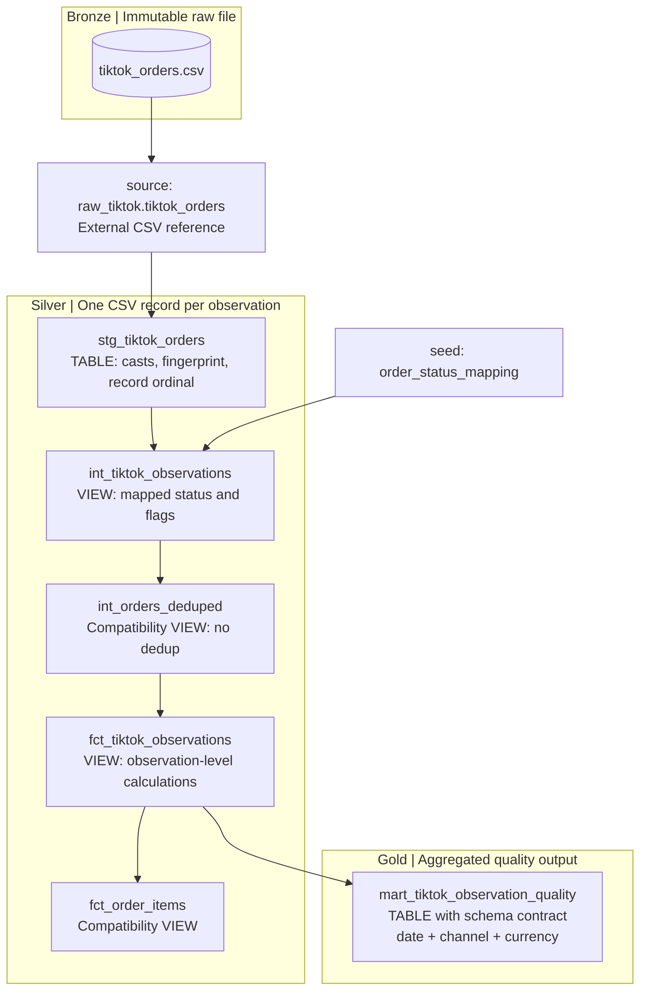

# TikTok snapshot pipeline — active model contract

Phạm vi: TikTok + dbt trong môi trường Dagster/DuckDB local hiện có. Không sửa CSV, Shopee hoặc code Streamlit. Masking được chấp nhận vì bảo mật; không khôi phục ID gốc.

## Active lineage — Bronze → Silver → Gold



| Logical layer | Current implementation | Grain / scope |
|---|---|---|
| Bronze | Original local CSV snapshots | Exported records preserved as received, including privacy masks |
| Silver | `staging/` plus active `intermediate/` models | One snapshot observation; casts, provenance, mapping and quality checks |
| Gold | `mart_tiktok_observation_quality` | One row per `(observation_date, source_channel, currency)` |

This is a logical medallion mapping on the existing local stack, not a schema rename or a new ingestion service. `source()` references the Bronze file; staging already transforms it, so staging belongs to Silver here. The mapping seed is reference data. Gold supports the stated quality-reporting scope, not verified order or customer identity. The two compatibility views are real dependency steps, not extra cleansing or aggregation layers.

`order_status_mapping` seed joins on `(source_channel, normalized status)`. Trim/uppercase and alias `CANCELED → CANCELLED` apply before mapping. Raw spelling stays in `raw_order_status`. Unknown mapping fails tests; duplicate mappings fail the seed uniqueness test rather than silently multiplying records. Returned is supported explicitly.

## Snapshot identity and types

- `observation_id = sha256(channel | whole_file_sha256 | CSV_record_ordinal)`. Ordinal is one-based and counts CSV records, including quoted multiline cells correctly.
- Preserve every record, including identical contents and repeated masks. `pk_id`, `order_id`, product/SKU/shop/buyer fields remain source labels, not unique business keys.
- A byte-identical rerun preserves observation IDs. Changed contents at the same path produce a new fingerprint and new IDs; this is snapshot lineage, not cross-snapshot entity identity.
- `_source_file`, `_file_sha256`, `_source_row_number`, `_ingested_at` provide provenance. `_ingested_at` is build time, not the source export date or market freshness.
- Source must stay immutable during a build; the single configured CSV is read for both data and fingerprint. Do not edit or replace it while dbt runs.
- Raw CSV columns are strings before explicit casts. Invalid dates/money fail the build. Optional missing dates/money remain null; no automatic imputation.
- Full refresh replaces staging and quality tables on every build. No unsafe masked-key incremental upsert/global timestamp watermark remains in the active lineage.
- Paths are configured with `TIKTOK_CSV_PATH`; default is `../data/raw/tiktok_orders.csv` from the dbt project directory. `DBT_DUCKDB_PATH` selects the output database. Use absolute paths when invoking outside the project directory.

## Fields for the dashboard handoff

| Field/model | Meaning |
|---|---|
| `fct_tiktok_observations` | Primary new relation: `main_intermediate.fct_tiktok_observations` under the current default schema |
| `observation_id` | Technical unique row key; use for observation joins |
| `raw_order_status`, `order_status`, `standardized_status`, `status_group` | Raw, normalized and mapped status separately |
| `is_completed`, `is_cancelled`, `is_returned` | Integer flags per observation, not per unique order |
| `observed_item_sales_value` | Reported item sale price × quantity for this observed record; not verified seller revenue |
| `observed_item_original_value`, `observed_item_price_difference` | Item-level observed calculations, not order totals |
| `amount_excluding_reported_shipping_tax_and_fees` | Former subtraction formula with an explicit name; NOT seller payout, settlement or profit |
| `has_complete_amount_components` | All six inputs to that formula are non-null; missing input yields null amount |
| `total_amount` and other header fields | Preserved for inspection; non-additive across observed records |
| `is_pk_masked`, `is_order_id_masked` | Coverage indicators; masking is expected, not a failing test |
| `mart_tiktok_observation_quality` | `main_marts.mart_tiktok_observation_quality`, grain `(observation_date, source_channel, currency)` |

The quality mart contains observation/status/masking counts, `delivery_sla_eligible_count`, on-time/late observation counts, timestamp coverage and incomplete amount-component counts. Calculate SLA coverage from eligible/observation counts. All figures refer to observations, never unique orders; separate currency groups.

There is deliberately no `net_revenue`, `is_successful_revenue` or AOV in the active model contract. Do not substitute a raw row count or distinct mask count for business order count.

## Retired models and existing dashboard

`fct_orders` and the five previous marts (`mart_daily_revenue`, `mart_product_performance`, `mart_geo_analysis`, `mart_fulfillment_sla`, `mart_financial_reconciliation`) have `enabled=false`. Their historical SQL is retained for reference, not executed. Their claimed order/product grain cannot be established with these masked identifiers.

**Disabling a dbt model does not drop pre-existing relations.** The original working warehouse and Streamlit app were not rebuilt or changed during this work. Existing legacy tables may still contain old results; they are not refreshed by the new build and must not be treated as newly validated output. Migrate the dashboard to the new model contract before using a newly built warehouse. Review/remove retired relations separately after that migration; no automatic destructive cleanup is performed.

`int_orders_deduped` and `fct_order_items` keep their names only to preserve lineage paths; descriptions and tests now use observation grain. Legacy `item_revenue` aliases are replaced by the explicit `observed_item_*` fields above.

## Local validation without touching the working database

From repo root, using the existing Python environment:

```powershell
.venv/Scripts/python.exe scripts/validate_tiktok_dbt.py
.venv/Scripts/python.exe scripts/validate_tiktok_dbt.py --real-data
```

The first command uses the checked-in synthetic fixture; the second also reads the local TikTok CSV. All builds use isolated copies of the dbt project and DuckDB databases below gitignored `.validation/`. Source CSV and the working warehouse are not written. Logs, manifests, run_results and latest_validation.json remain there for inspection.

Regression scenarios: masked-key collision, identical records, multiline CSV cells, status aliases/return mapping, missing fee input, separate currencies, identical rerun, changed file at the same path, unknown status, zero quantity, malformed money, duplicate status mapping. Bad inputs must fail for the expected reason. Real-data mode reconciles all source observations and fingerprints.

For a separate manual validation DB, from `dbt_transforms`:

```powershell
$env:DBT_DUCKDB_PATH = '../data/duckdb/tiktok_validation.duckdb'
../.venv/Scripts/dbt.exe build --target ci --profiles-dir . --full-refresh
Remove-Item Env:DBT_DUCKDB_PATH
```

Tests use the installed dbt Core/adapter and modern generic-test `arguments` syntax (Core >=1.10.5). No dependency installation/upgrade is performed by the local validator. The CI installs project requirements and runs the fixture suite; it needs no private CSV.

Before launching/reloading Dagster after pulling the model changes, regenerate its manifest from `dbt_transforms`:

```powershell
../.venv/Scripts/dbt.exe parse --profiles-dir . --no-partial-parse
```

Then run the existing `dagster dev -m pipeline_orchestration.definitions` command from repo root. Parse regenerates metadata only. Keep writers to the same local DuckDB serialized, release Streamlit's cached connection before a working-DB build, and distinguish stored legacy outputs from the active manifest.
