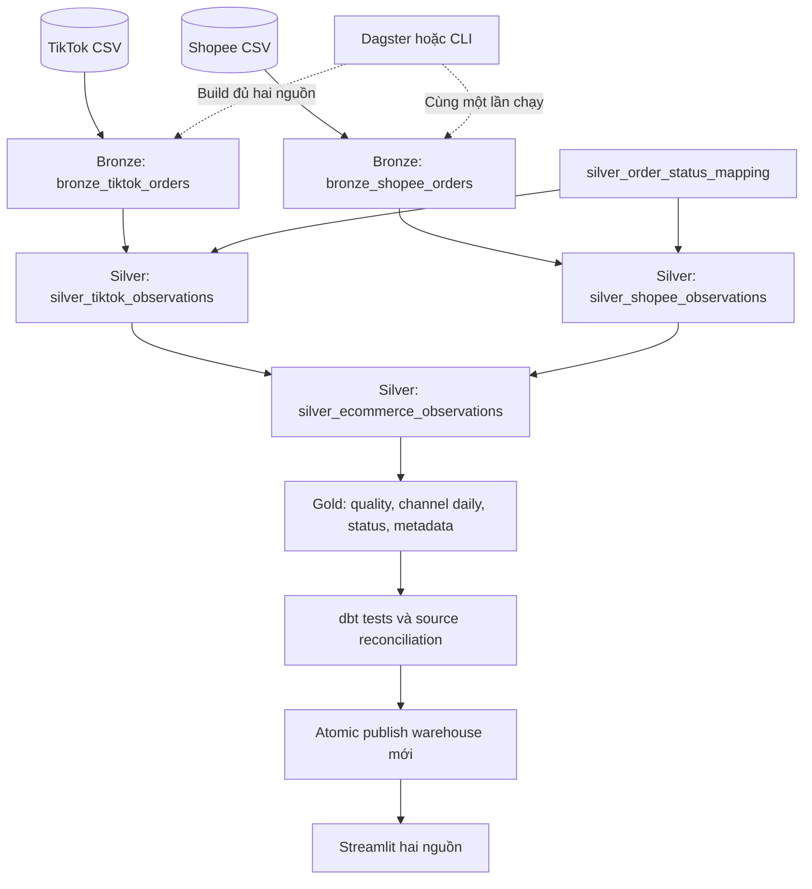

# Trạng thái triển khai — Medallion hai nguồn

Cập nhật 19/10/2026 theo yêu cầu giữ stack local, đổi tên các tầng/bảng đồng bộ và triển khai Shopee end-to-end. Stack: Dagster + dbt-duckdb + DuckDB + Streamlit; masking được chấp nhận vì bảo mật.

## 1. Phạm vi thực hiện

- Folder models: `bronze/`, `silver/`, `gold/`.
- Schemas vật lý đúng `bronze`, `silver`, `gold`, không dùng `main_staging`/`main_intermediate`/`main_marts` cho nhánh mới.
- Prefix model/table cùng layer, ví dụ `bronze.bronze_shopee_orders` và `silver.silver_shopee_observations`.
- Hai bảng Bronze giữ mọi cột nguồn là VARCHAR và thêm technical metadata; Silver là nơi staging/ép kiểu và chuẩn hóa.
- Shopee đã có typed/native money fields, normalized status, observations chung và Gold marts; dashboard đọc bốn Gold tables.
- Dagster và CLI dùng candidate DB, tests/validation và atomic publication; không chuyển Airflow/Docker.

## 2. Data flow



Lineage vật lý đầy đủ và metric contract: [models README](../dbt_transforms/models/README.md). Kiến trúc tổng thể và lệnh chạy: [README](../README.md), [cheatsheet](../CHEATSHEET.md).

## 3. Dữ liệu và metric

Nguồn là hai snapshot DataGrip của bộ `vietnam_ecommerce`. CSV hợp lệ, nhiều ID/nhãn đã mask. Gold mô tả observations và coverage, không phục hồi số đơn/SKU gốc hoặc suy ra thị phần.

- Không dedup theo masked PK/order ID; technical row identity dùng channel/file hash/CSV record ordinal.
- Shopee missing price giữ null và bị loại khỏi priced-unit denominator, không tự điền original price hoặc 0.
- `TO_RETURN` chuẩn hóa thành `RETURN_REQUESTED`, không đếm là completed return.
- Fee/voucher/escrow Shopee được giữ riêng trong Silver; negative escrow không bị clamp. Không tự map thành payout hoặc net revenue TikTok.
- Delivery/SLA Shopee chưa có trường tương đương thì giữ null; coverage 0 không phải một SLA rate đã đo.
- Currency tách riêng; dashboard chọn một currency và tính lại weighted metrics từ numerator/denominator tổng.
- Kỳ giao nhau theo ngày là một filter, chưa chứng minh cùng population/sampling hoặc completeness.

## 4. Migration an toàn

Warehouse phục vụ mới: `data/duckdb/ecom_medallion.duckdb`. File legacy `ecom_warehouse.duckdb` được giữ nguyên để đối chiếu. Model cũ/compatibility paths đã được thay bằng graph Medallion, không rename/drop destructive bảng trong legacy DB.

Candidate có đủ cả hai sources và Gold tables; kiểm tra schema/table names, record counts, keys, source fingerprints và dbt results trước publication. Lỗi trước publish giữ bản phục vụ cũ. Backup được lưu khi thay một warehouse Medallion đã có. CLI/Dagster có cùng writer lock; Streamlit cache dataframes và đóng connection, hỗ trợ thay file khi build thành công.

## 5. Kiểm chứng và vận hành

```powershell
.venv/Scripts/python.exe scripts/validate_ecommerce_dbt.py --real-data
.venv/Scripts/python.exe scripts/validate_dashboard.py
.venv/Scripts/python.exe scripts/build_warehouse.py
```

Validation chạy trong DB/project riêng. Bộ fixture test cả hai nguồn, masking collisions, exact duplicates, multiline records, typed money/quantity/status, mapping fan-out, changed snapshot isolation, publication và failed-build recovery. CI chạy fixture và UI filters mà không cần CSV riêng tư.

Dagster asset group `ecommerce_dbt_assets` cần được materialize toàn bộ cho mỗi candidate; partial selection bị từ chối. Lịch 07:00/15:00 theo Asia/Ho_Chi_Minh vẫn là các schedule local, không mang ý nghĩa nguồn snapshot được cập nhật mỗi ngày.

## 6. Phần để mở rộng sau

Buổi tiếp theo có thể ưu tiên dashboard: so sánh hai kỳ và drill-down từ ngày/trạng thái xuống observations. Các ý tưởng khác gồm lịch sử pipeline health, export CSV theo bộ lọc và tinh chỉnh giao diện. Các nâng cấp này chưa triển khai; tiếp tục giữ grain observation và tách currency.

Incremental/backfill khi có update semantics rõ, metric order/product khi có stable pseudonymous keys, dictionary của phí/settlement nếu có thêm tài liệu. Các hạng mục này không là điều kiện để pipeline snapshot hai nguồn chạy đúng ở grain đã công bố.

Các tài liệu [CSV audit](upgrade/CSV_AUDIT.md), [source contract](upgrade/SOURCE_CONTRACTS.md) và notebook giữ lại bằng chứng gốc; các nhận xét công nghệ/phạm vi trong audit được hiểu theo thời điểm audit, không thay thế trạng thái triển khai hiện tại.

## 7. Kết quả xác minh triển khai

- Build full hai snapshot và publish `ecom_medallion.duckdb` thành công: TikTok 102.000 observations, Shopee 25.546; union 127.546.
- 99 dbt data tests đạt trên fixture và hai CSV local; schema contracts của Gold đạt.
- Kiểm chứng Bronze giữ raw types, status/quantity/money rejection, mapping fan-out, rerun, changed-source identity isolation và failed-build giữ bản cũ đã đạt.
- Dagster materialize đầy đủ fixture 8 TikTok + 7 Shopee, dbt tests và publication đạt; executable ưu tiên dbt cùng Python environment.
- Streamlit AppTest đạt cho kỳ giao nhau/toàn kỳ, source/currency filters, lựa chọn rỗng và database chưa tồn tại. Cache không giữ connection.
- 10 bảng vật lý trong đúng ba schema (2 Bronze, 4 Silver bao gồm reference seed, 4 Gold). Các source fingerprints không đổi sau triển khai; legacy warehouse được giữ nguyên.

Bộ kiểm tra bổ sung: `scripts/validate_dagster.py` dùng fixture và database riêng. Trên Windows sandbox hạn chế socket, Streamlit/Dagster smoke tests cần môi trường cho phép socket nội bộ; tests đã chạy thành công ngoài sandbox. Đây không phải yêu cầu thêm service hoặc đổi stack.
