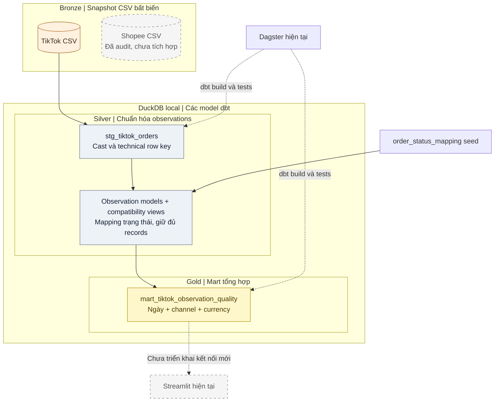

# Kế hoạch cải thiện pipeline trên môi trường hiện tại

Cập nhật ngày 19/10/2026 theo quyết định của người dùng: **giữ Dagster và môi trường local ban đầu; chấp nhận masking để bảo vệ người dùng; tập trung chất lượng dữ liệu và dbt.** Tài liệu này thay thế phương án chuyển Airflow/Docker trước đó. Nhánh TikTok và quality tests đã triển khai; trạng thái chi tiết ở mục 9.

## 1. Phạm vi đã chốt

| Thành phần | Quyết định |
|---|---|
| Orchestration | Giữ Dagster và tích hợp `dagster-dbt` hiện có |
| Môi trường | Giữ Python/uv/`.venv` local; dùng các lệnh chạy hiện tại |
| Analytical engine | Giữ DuckDB local |
| Transformation | Giữ dbt-duckdb, cải thiện logic, tests và tài liệu |
| Dashboard | Giữ Streamlit; điều chỉnh chỉ số theo bằng chứng dữ liệu |
| Input | Hai CSV TikTok và Shopee đã xuất trực tiếp từ DataGrip |
| Masking | Đặc tính đầu vào được chấp nhận vì bảo mật, không đặt mục tiêu giải che |

Airflow, Docker/Compose, PostgreSQL metadata, migration orchestrator và nâng cấp đồng loạt dependency nằm ngoài đợt này. Không yêu cầu truy cập lại database cũ hoặc tìm lại ID gốc để tiếp tục.

Mục tiêu: chạy đúng trên các snapshot hiện có, bảo toàn dòng quan sát và công khai giới hạn chỉ số. Tối ưu độ phức tạp trước khi mở rộng phạm vi.

## 2. Bằng chứng hiện có

- Người dùng xác nhận nguồn `vietnam_ecommerce` của Xóm Dataset, kết nối và export bằng DataGrip; không có script extraction riêng.
- Audit toàn bộ CSV: TikTok 102.000 dòng/71 cột; Shopee 25.546 dòng/84 cột. Strict CSV parse đạt, không có record lệch cột hoặc trùng hoàn toàn.
- `pkId`, mã đơn và nhiều nhãn/ID đã che bằng `*`. Đây là cơ chế bảo vệ dữ liệu được chấp nhận; số distinct masks không được hiểu thành số entity gốc.
- Một số cột tiền/thời gian thiếu hoặc có ngoại lệ cần quy tắc xử lý, không tự coi tất cả là lỗi nguồn.

Chi tiết: [CSV audit](upgrade/CSV_AUDIT.md), [notebook](upgrade/csv_audit.ipynb), [SQL và kết quả kiểm tra](upgrade/csv_audit_evidence.json), [hợp đồng nguồn](upgrade/SOURCE_CONTRACTS.md). Các báo cáo audit giữ nguyên bằng chứng đã quan sát; việc chấp nhận masking không thay đổi khả năng phân biệt ID gốc.

## 3. Kiến trúc giữ lại — Bronze → Silver → Gold

Mũi tên liền: luồng dữ liệu active sau khi build. Nét đứt có nhãn: điều phối hoặc kết nối dự kiến. Shopee chỉ có snapshot trong Bronze, chưa có nhánh dbt; Streamlit hiện chưa đọc Gold mart mới. Sơ đồ rút gọn các compatibility views trong node observation models; lineage đầy đủ nằm trong [model contract](../dbt_transforms/models/README.md).

| Tầng logic | Thành phần | Trách nhiệm |
|---|---|---|
| Bronze | Hai CSV gốc trong `data/raw/` | Bảo toàn dữ liệu đã che và khả năng reprocess |
| Silver | TikTok staging + observation models trong intermediate | Cast, technical lineage, status mapping, tests; giữ grain observation |
| Gold | Quality mart trong `models/marts/` | Tổng hợp observations và coverage, tách currency |

Tên Bronze/Silver/Gold mô tả trách nhiệm dữ liệu, còn staging/intermediate/marts mô tả cách tổ chức code dbt. Staging đã làm sạch/ép kiểu nên thuộc Silver trong project này. Không cần đổi folder/schema hay thêm dịch vụ để thể hiện mapping logic. Gold không bao hàm việc đã xác thực KPI đơn/SKU từ masked IDs.

Các model vẫn chạy bằng dbt-duckdb và lưu trong DuckDB local. Bronze hiện là snapshot file, không phải raw table append history; không thêm landing Parquet hoặc hệ thống lakehouse đầy đủ vào scope này.

Dagster tiếp tục gọi một `dbt build` theo luồng hiện có. Các lần ghi cùng warehouse phải được chạy tuần tự; khi kiểm thử trên local có thể đóng dashboard/release connection trước khi build để tránh lock. Nếu xung đột ảnh hưởng việc sử dụng thực tế, xử lý vòng đời connection hoặc thêm bản read-only sau khi đo được nhu cầu.

## 4. Cách làm việc với dữ liệu đã che

1. Giữ nguyên CSV gốc và giá trị đã mask, không giải che hoặc cố nhận diện người dùng.
2. Dùng `(source_channel, file_sha256, record_ordinal)` làm khóa kỹ thuật cho một dòng quan sát trong snapshot; ordinal tính theo record CSV, không theo physical line. Khóa này phục vụ bảo toàn và truy vết, không đại diện cho đơn hay khách hàng.
3. Không dedup bằng masked `pkId`, masked order ID hoặc hash của chúng. Với snapshot cố định, full refresh là baseline đơn giản; giữ tất cả observations trừ khi chứng minh được quy tắc duplicate hợp lệ.
4. Giữ raw status và standardized status; dùng seed mapping đã có, ghi nhận status chưa map.
5. Chuẩn hóa từng nguồn riêng; chỉ union những trường có ý nghĩa tương đương đã kiểm tra. Giữ riêng các trường tiền chưa có định nghĩa chung.
6. Không yêu cầu order key phải khôi phục được để xây staging, chất lượng cột và mart observations. Những metric cần order key sẽ được ghi rõ chưa đủ căn cứ.
7. Fixture nhỏ có grain rõ chỉ phục vụ test các trường hợp đã biết, không thay bộ CSV chính bằng một dự án dữ liệu giả khác.

## 5. Những việc cần sửa trước

| Ưu tiên | Vấn đề hiện tại | Hướng xử lý |
|---|---|---|
| P0 | `int_orders_deduped` dùng masked `pk_id` | Thay vai trò dedup bằng mô hình giữ observations với technical row key; cập nhật tests cùng semantics |
| P0 | Fact so status dạng `Completed`, raw dùng `COMPLETED` | Chuẩn hóa status và dùng mapping chung thay vì so sánh rải rác |
| P0 | `fct_orders` gộp theo masked order ID | Không tiếp tục trình bày output đó như số đơn đã xác thực; tách lớp observations khỏi fact nghiệp vụ |
| P0 | Nhãn net revenue/thực nhận chưa có đối soát | Dùng tên phản ánh đúng phép tính; giữ buyer paid, fee, discount, escrow riêng theo nguồn |
| P1 | Chưa có staging Shopee | Thêm model và YAML riêng cho 84 cột; cấu hình đường dẫn local rõ ràng |
| P1 | Mart sản phẩm gồm mọi status và đếm tỷ lệ khác grain | Chốt population, numerator/denominator ở cùng grain; chưa gọi masked SKU là sản phẩm duy nhất |
| P1 | Mart/dashboard chưa giữ channel/currency | Group/filter theo channel và currency; không cộng các currency với nhau |
| P1 | Geo chart đếm số nhóm trong mart | Sửa phép tổng hợp và nhãn theo grain được chọn; nhãn địa lý Shopee đã mask cần ghi giới hạn |
| P1 | CI mới compile | Build/test thật trên fixture nhỏ, không cần thay môi trường hay dùng dữ liệu raw công khai |
| P2 | README/lịch chạy/manifest bootstrap chưa nhất quán | Cập nhật hướng dẫn local và timezone; bảo đảm fresh setup tạo manifest trước khi load Dagster assets |

Các sửa đổi ở fact/mart cần cùng lúc cập nhật dashboard và tests để người dùng không tiếp tục đọc số cũ với nhãn mới. Xác minh trong DuckDB tạm trước khi thay warehouse đang dùng.

## 6. Phạm vi phân tích thực tế

| Nhóm | Có thể làm ở đợt này | Giới hạn cần hiển thị |
|---|---|---|
| Chất lượng dữ liệu | Null/cast/mapping/coverage theo source và thời gian | Counts là observations, không phải đơn |
| Trạng thái | Phân bố trạng thái trên các dòng quan sát của từng nguồn | Không gọi là tỷ lệ hủy theo đơn; cần kiểm tra grain trước khi so giữa hai nguồn |
| Giá/số lượng/discount | Khảo sát phân bố các trường có semantics rõ, chia currency | Không cộng tiền header trên mọi line; không gọi là market price hay quan hệ nhân quả |
| Vận hành | Duration trên tập có đủ timestamp tương đương, kèm coverage | Không thay completed time bằng delivered time; các dòng không đủ mốc giữ missing |
| Theo đơn | Order count, AOV, basket và tiền header tổng | Tạm chưa coi là KPI đã xác thực vì masked keys không đủ phân biệt đơn |
| Theo entity | Cùng SKU/shop/customer giữa hai kênh, retention | Chưa có mapping đáng tin từ masked identifiers |

Mục tiêu so sánh Shopee–TikTok vẫn giữ, nhưng bắt đầu bằng schema/coverage và các phân bố tương thích trong dataset. Không đặt việc phải suy ra insight thị trường lớn làm điều kiện hoàn thành project.

## 7. Lộ trình gọn

| Mốc | Công việc | Điều kiện hoàn tất |
|---|---|---|
| A — Baseline | Chốt source contract và metric glossary, lưu audit, tạo fixture regression nhỏ | Ghi rõ masking được chấp nhận; mọi test phân biệt raw-row key và business key |
| B — Sửa TikTok | Bảo toàn observations, sửa status và cách tính/đặt tên metric, cập nhật dashboard liên quan | Không âm thầm loại dòng do masked PK; dbt build/test trong DB tạm đạt; số hiển thị có grain đúng |
| C — Thêm Shopee | Staging riêng, canonical observation fields, status/currency/null handling | Hai nguồn chạy được bằng Dagster hiện tại; raw row count được đối chiếu đầy đủ |
| D — Marts tối thiểu | Chất lượng/coverage và các chỉ số mô tả tương thích; ghi rõ unavailable metrics | Streamlit phân biệt channel/currency; không hiển thị số đơn/AOV suy từ mask như KPI đáng tin |
| E — Hoàn thiện | CI fixture, local runbook, docs dbt và lịch Dagster phù hợp snapshot | Chạy lại cùng input cho kết quả không đổi; fresh setup được hướng dẫn rõ |

Chưa đưa incremental/backfill mô phỏng vào điều kiện nghiệm thu đợt này. Khi full refresh đúng và có nhu cầu học tiếp, mới cân nhắc mở rộng trong cùng stack.

## 8. Kiểm chứng phù hợp

- Full refresh hai snapshot trong DB tạm, đối chiếu số observations theo source với CSV.
- Required fields/casts, currency/status domains và mapping coverage.
- Technical raw-row key unique và not-null; không đặt unique test cho masked business IDs như thể chúng là ID gốc.
- Regression: hai ID gốc có cùng prefix mask vẫn giữ đủ hai observations; retry cùng snapshot không làm tăng dòng; status mapping đúng.
- Metric tests chỉ áp dụng trên grain đã xác định; fixture giúp kiểm tra fan-out và logic nhạy cảm.
- Dashboard hiển thị data coverage và ngày build riêng; chạy lại snapshot không được diễn giải là có dữ liệu thị trường mới.
- Nếu cần kiểm tra header/order logic trên fixture thì ghi rõ phạm vi fixture; không lấy kết quả đó làm bằng chứng đã khôi phục order identity của CSV.

## 9. Trạng thái hiện tại

Đã triển khai phần TikTok và chất lượng dbt: giữ mọi CSV observation, nối status mapping, thêm technical row key, quality mart/schema contract, data tests và CI fixture regression. Đã build/test dữ liệu TikTok trên DB tạm; 102.000 observations được giữ đủ và 51 data tests đạt. Dagster giữ nguyên cơ chế điều phối; manifest đã parse lại. Shopee, code dashboard và warehouse đang dùng chưa bị sửa/build lại. Các mart theo đơn/SKU cũ đã ngưng build; bảng cũ trong warehouse nếu còn sẽ không tự bị xóa hoặc refresh. Xem [active model contract và hướng dẫn bàn giao dashboard](../dbt_transforms/models/README.md).
